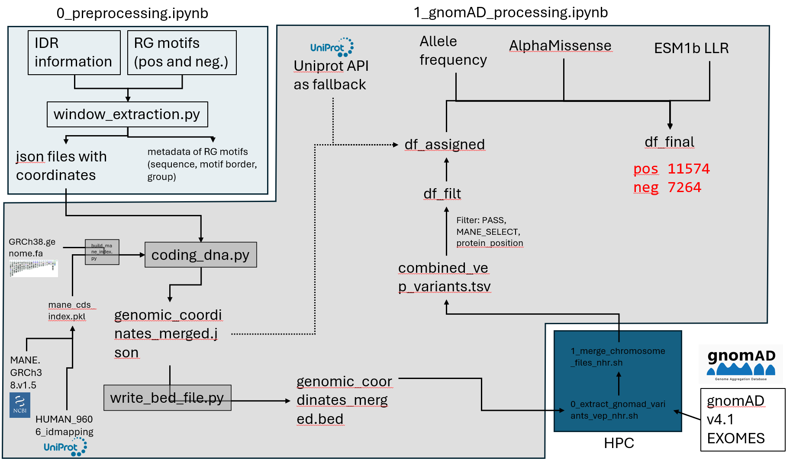

# Population genetic constraint identifies functional RG motifs and predicts novel RNA-binding proteins

Code and data accompanying the manuscript *"Population genetic constraint identifies functional RG motifs and predicts novel RNA-binding proteins"* (Schumbera, Morett, Cihan & Andrade-Navarro; under revision at *NAR Genomics and Bioinformatics*). A link to the publication will be added upon acceptance.

## Overview

RG/RGG motifs are short, low-complexity sequences in intrinsically disordered regions that mediate RNA binding and phase separation, yet only some of them are functional. This repository uses purifying-selection signals from human population variation (gnomAD v4.1) to distinguish functional from non-functional RG motifs, and trains a Random Forest classifier on these signals to nominate novel candidate RNA-binding proteins.

## Repository structure

```
├── data/
│   ├── external/                          # Raw external data (UniProt, gnomAD, PhaSePred, …)
│   ├── processed/                         # Processed datasets used by the analysis notebooks
│   └── results/                           # Output tables
├── figures/                               # Subfigures to recreate the figures of the publication
├── models/                                # Trained Random Forest model(s)
├── src/                                   # Helper functions used by the notebooks
├── docs/                                  # Documentation assets (e.g. data flow diagram)
├── 0_preprocessing.ipynb                  # Builds, cleans and annotates the proteome/RG motif datasets
├── 1_gnomAD_processing.ipynb              # Maps gnomAD variants to RG motifs and computes constraint metrics
├── 2_variant_analysis_visualization.ipynb # Statistical analysis and visualization of variant constraint
├── 3_RF_model_creation.ipynb              # Training and evaluation of the Random Forest classifier
├── 4_inference_rg_motifs.ipynb            # Prediction of functional RG motifs and novel RNA-binding candidates
├── environment.yml                        # Conda environment
├── LICENSE
└── README.md
```

## Data flow

The diagram below summarizes data acquisition, processing and organization performed in `0_preprocessing.ipynb` and `1_gnomAD_processing.ipynb`, which are prerequisites for the downstream analyses.



## Installation

All dependencies are listed in `environment.yml`. Using Conda:

```bash
git clone https://github.com/erschumb/evolutionary_RG_signal_classifier.git
cd evolutionary_RG_signal_classifier
conda env create -f environment.yml
conda activate <env-name>   # name defined in environment.yml
```

### Data not included in this repository

Due to its size, `human_reviewed.json` from [PhaSePred](http://predict.phasep.pro/) (phase-separation propensity scores for all reviewed human proteins) is not included.

- Download: <http://predict.phasep.pro/static/phasepred/database/human_reviewed.zip>
- Version used: release of 11 Feb 2022, downloaded 13 Jun 2023 (still the latest release as of 1 Jul 2025)
- Unzip it into `data/external/`. The exact file used can be provided on request (see [Contact](#contact)).

## Usage

1. Run `0_preprocessing.ipynb` to create, clean and annotate the required datasets.
2. Run `1_gnomAD_processing.ipynb` to map population variants and compute constraint metrics.
3. Notebooks `2`–`4` can then be run, modified or extended independently of each other.

## Citation

If you use this code or data, please cite the publication (citation will be added upon acceptance).

## License

See [`LICENSE`](LICENSE).

## Contact

Eric Schumbera — [e.schumbera@uni-mainz.de](mailto:e.schumbera@uni-mainz.de)
